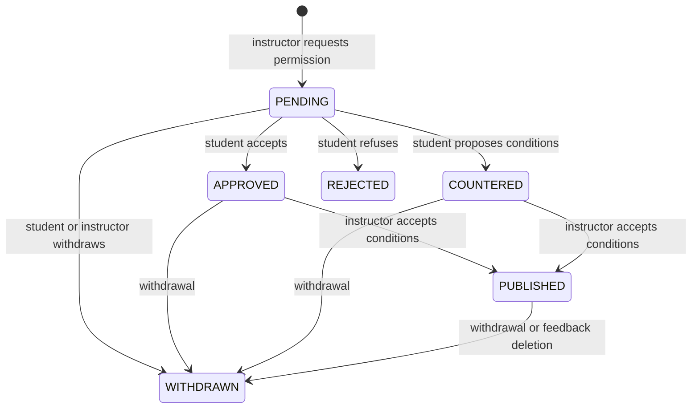

# Student feedback, sharing consent and discussions

This backend app provides three separate flows: private feedback and replies,
negotiated sharing permission, and published discussions with optional polls.
Frontend screens are a separate team task. Existing login, courses, grades and
timetables are unchanged.

## Roles and privacy

Students choose `INSTRUCTOR` (one selected instructor), `HEAD` (department heads)
or `BOTH` when submitting feedback. Other students and unrelated instructors
cannot read the private feedback or its replies. HEAD means heads of the
feedback's department, using Poyraz's existing `departments.Department` model.
The department comes from the student's account at submission and is stored on
the feedback. A later student transfer does not move the conversation or its
approved audience. ADMIN retains university-wide audit access.

`is_anonymous` defaults to true. The chosen recipients see an anonymous label and
null student ID, including in private replies. An identified submission exposes
the student's ID and display name, not email or student number.

**ADMIN has audit access to all feedback, private replies, sharing negotiations,
discussions, comments and votes, including student identity and withdrawn/deleted
records.** Anonymity is not anonymity from ADMIN. `admin_audit_access: true` is
included in feedback/sharing/discussion responses. The frontend must explain this
before submission and before asking for sharing consent. Django `is_staff` and
`is_superuser` are not substitutes for the application's ADMIN role.

Only the submitting student can delete feedback. Deletion withdraws its sharing
request/discussion and removes ordinary access; it is a **soft deletion**, with
records retained for ADMIN audit. A student can instead withdraw sharing consent
to keep the private feedback conversation. There is no hard-delete endpoint.

## Consent workflow

1. The selected INSTRUCTOR prepares a sharing proposal: their introduction,
   student/HEAD visibility, identity disclosure, comment/result visibility, and
   optionally a poll with options and a deadline. The original feedback remains
   unchanged. Private replies are never copied into a discussion.
2. The student receives an **in-app notification**. They can inspect the exact
   original text, introduction, poll and all visibility settings before deciding.
3. The student approves, rejects, or supplies a full set of alternative conditions.
   For example: HEAD may see it, other students may not, and identity stays hidden.
4. The instructor explicitly accepts the student's conditions and publishes. The
   server uses the saved student conditions, never replacement visibility fields
   in the publish request. Without approval/counter-conditions, publication is blocked.
5. Rejection leaves private replies open. There is one sharing request/discussion
   per feedback; rejection or withdrawal cannot be bypassed with repeated requests.
6. The student or requesting instructor can withdraw sharing. It cannot then be
   republished. ADMIN retains the audit trail but cannot approve on the student's
   behalf or publish on the instructor's behalf.



The original audience and the shared audience are independent. If the original
feedback was sent to HEAD, turning off HEAD visibility for the discussion does
not revoke HEAD access to that original private feedback. ADMIN audit access is
always enabled and is not a negotiable checkbox.

Proposal text, poll, deadline and visibility are immutable through PATCH/PUT.
Student counter-conditions become the effective visibility at publication. The
poll deadline is not extended while consent is pending; a late publication can
therefore contain an already-closed poll. Private feedback text is also immutable
after submission; use replies for clarification or delete the feedback.

## Discussion and poll rules

- If student visibility is approved, the discussion appears to **all STUDENT
  accounts in the feedback's department**, not a course cohort. The original author can always
  view their published discussion. Only the requesting instructor can view it
  as INSTRUCTOR. HEAD needs both matching department membership and the approved
  HEAD visibility; ADMIN always sees it.
- Students with access and the requesting instructor can comment. HEAD and ADMIN
  can read but do not post discussion comments. ADMIN can reply in private threads.
- When student comments are hidden, a student sees only their own comments and
  the instructor's comments. The instructor and authorized HEAD/ADMIN see all.
- The original author's identity remains hidden in shared comments and their
  individual vote when `reveal_identity` is false, except to the author and ADMIN.
  Other participating students' comments/votes are identified. There is no
  general anonymous-vote option; explain this before voting.
- Polls are optional, single-choice, with 2–10 distinct options. Agree/disagree
  is simply a two-option poll. An open discussion can omit the poll entirely.
- Students can change their single vote until `poll_closes_at`. The deadline is
  exclusive. Options and the deadline cannot be changed after requesting consent.
  Comments remain open after the poll closes, until sharing is withdrawn.
- Hidden results are returned as `null`, with no total or option counts leaked.
  A student can still see their own selection. The requesting instructor and ADMIN
  always see aggregates; HEAD sees aggregates only if granted discussion access.
- Only the requesting instructor and ADMIN can list individual votes and their
  last update times. For an anonymous original author, their identity stays masked
  from the instructor. Other voters' identities are visible to that instructor.
- Counts and percentages are returned for frontend charts. There is no standalone
  instructor poll unrelated to a feedback item in this module.

## Files and integration

| Files | Responsibility |
| --- | --- |
| `models.py`, `migrations/` | Feedback, replies, sharing state, comments, votes, notifications. |
| `access.py` | Central role/recipient visibility and identity masking. |
| `serializers.py`, `views.py`, `services.py` | Private feedback and replies. |
| `consent_serializers.py`, `consent_views.py`, `consent_services.py` | Proposals, conditions, notifications and publication. |
| `discussion_serializers.py`, `discussion_views.py`, `discussion_services.py` | Discussions, comments and voting/results. |
| `pagination.py`, `urls.py` | List response sizes and explicit routes. |
| `tests/` | Recipient privacy, consent, polls, real JWT and concurrent operations. |

Integration adds only an app entry to `config/settings.py`, a URL include to
`config/urls.py`, and a README link. The existing `accounts` authentication and
permissions are reused. Department membership reuses `departments.Department`
and `accounts.User.department`; the courses and registration apps are unchanged.
There is no new Python dependency or production service.

Write services use database transactions and always lock the source Feedback
before its SharingRequest. This prevents a concurrent publish/delete/withdrawal
from leaving withdrawn consent public. A unique vote constraint plus the same
locking ensures one vote per student. Notifications are written in the same
transaction as the action. No email, push provider, background worker or WebSocket
is required; the frontend reads the in-app notification API.

## Endpoints

Base `/api/feedback/`, with trailing slashes. All endpoints require the existing
JWT and completed first password change. Send JSON and `Authorization: Bearer ...`.

| Method | Path | Purpose |
| --- | --- | --- |
| GET | `instructors/` | STUDENT: active instructor IDs/names for recipient selection. |
| GET, POST | `items/` | List only visible private feedback; STUDENT submits. |
| GET, DELETE | `items/{id}/` | Visible detail; owner STUDENT soft-deletes. |
| GET, POST | `items/{id}/replies/` | Private replies among original recipients/author and ADMIN. |
| POST | `items/{id}/sharing-request/` | Selected INSTRUCTOR requests sharing permission. |
| PATCH | `items/{id}/` | ADMIN only: assign `department` to an unassigned legacy record. No content editing. |
| GET | `sharing-requests/` | Author's or requesting instructor's requests; ADMIN sees all. |
| GET | `sharing-requests/{id}/` | Full proposal, state and student conditions. |
| POST | `sharing-requests/{id}/respond/` | Owner STUDENT approves, rejects or proposes conditions. |
| POST | `sharing-requests/{id}/publish/` | Requesting INSTRUCTOR publishes exact accepted conditions. |
| POST | `sharing-requests/{id}/withdraw/` | Owner STUDENT or requesting INSTRUCTOR withdraws. |
| GET | `notifications/` | Current user's in-app notifications, optionally `?unread=true`. |
| POST | `notifications/{id}/read/` | Current recipient marks a notification read. |
| GET | `discussions/` | Only discussions visible to the current role/account. |
| GET | `discussions/{id}/` | Original quotation, instructor introduction and poll/results. |
| GET, POST | `discussions/{id}/comments/` | Read permitted comments; eligible users comment. |
| POST | `discussions/{id}/vote/` | STUDENT creates or replaces their single vote. |
| GET | `discussions/{id}/votes/` | Requesting INSTRUCTOR/ADMIN: paginated voter report. |

All lists return `{count, next, previous, results}`, default 20 items; use `page`
and `page_size` (maximum 100). Feedback, requests and notifications are newest
first; discussions sort by publication newest first; replies/comments are oldest
first. Votes sort by last update. Unknown query fields do not broaden visibility.
`notifications/?unread=false` lists read records; omit the filter for all records.
The filtered `count` supports an unread badge.

### Submit and reply

```json
{
  "title": "More worked examples",
  "body": "Could we include more step-by-step examples?",
  "audience": "INSTRUCTOR",
  "instructor": 4,
  "is_anonymous": true
}
```

POST to `items/` returns 201 with the item ID, those fields, `student: {id, name}`,
`created_at`, `deleted_at` and `admin_audit_access: true`. The student identity is
viewer-specific; anonymous recipients receive `{id: null, name: "Anonymous student"}`.
For HEAD-only feedback, omit `instructor` or send null. `BOTH` requires one.
The account must have an active department. The server supplies `department`;
a forged department in the body cannot override membership. Private feedback,
sharing proposals and discussions return `department` and `department_name`.
The selected instructor may belong to another department: the course catalog
supports cross-department teaching, including university-wide electives.
Title is required, max 200; body required, max 5000. Content is plain text.

POST to `items/{id}/replies/` with `{"body":"Here is another example."}` returns
201 with `{id, author: {id, name}, body, created_at}`. Reply body max 3000.
The server chooses the author. DELETE of an owned item returns 204.

### Request sharing

POST to `items/{id}/sharing-request/` as the selected instructor:

```json
{
  "introduction": "Would more examples help you too?",
  "visible_to_students": true,
  "visible_to_heads": false,
  "reveal_identity": false,
  "show_results_to_students": false,
  "show_comments_to_students": true,
  "poll_question": "Would more worked examples help?",
  "poll_options": ["Agree", "Disagree"],
  "poll_closes_at": "2026-12-01T18:00:00+03:00"
}
```

Replace the illustrative deadline with a future time. All five visibility
booleans are required and at least students or heads must be selected. Introduction
is optional, max 3000. Poll question max 300, each option max 120. A poll requires
an offset-aware future deadline. To omit the poll, omit its three fields.

The 201 proposal contains `id`, `feedback` ID, viewer-safe `student`, `instructor`
ID, `feedback_title`, `feedback_body`, `introduction`, `state`, `conditions`,
`student_conditions` (initially null), the poll fields, `created_at`, `responded_at`,
`published_at`, and `admin_audit_access`. `conditions` is the instructor's proposal
until publication; publication replaces it with the saved student conditions.

### Respond and publish

POST to `sharing-requests/{id}/respond/` as the original student:

```json
{"action": "approve"}
```

Or reject with `{"action":"reject"}`. To offer different conditions:

```json
{
  "action": "counter",
  "conditions": {
    "visible_to_students": false,
    "visible_to_heads": true,
    "reveal_identity": false,
    "show_results_to_students": false,
    "show_comments_to_students": false
  }
}
```

All five counter-condition fields are required. The instructor then POSTs
`{"accept_conditions":true}` to `sharing-requests/{id}/publish/`. Other supplied
visibility fields cannot override student consent. Both actions return the full
proposal object with 200. Withdrawal takes POST `{}` and returns the withdrawn
proposal. Repeated withdrawal does not create duplicate notifications.

### Discussions, votes and notifications

Discussion objects contain `id` (the sharing-request ID), `title`,
`original_feedback`, viewer-safe `student` and `instructor` objects, `introduction`,
`state`, effective `conditions`, `poll`, `published_at` and `admin_audit_access`.
They do not include private conversation replies.

When present, `poll` has `question`, `options: [{index, label}]`, `closes_at`,
`is_closed`, `my_option` (integer or null) and `results`. Visible results have
`total_votes` and `options: [{index, label, votes, percentage}]`; hidden results
are null. Empty visible polls return zero counts/percentages.

POST `{"body":"I agree; more examples would help."}` to comments (max 3000).
Comment responses match private replies' shape. POST `{"option":0}` to vote;
indexes start at zero. Success is 200 with `{option, updated_at}`. Individual
vote reports contain `{student: {id, name}, option, updated_at}`.

Notification objects: `{id, feedback, sharing_request, event, is_read, created_at}`.
Events are `feedback_received`, `private_reply`, `sharing_requested`,
`sharing_responded`, `sharing_published`, `sharing_withdrawn`, `discussion_comment`.
They contain no message body or identity. Use the IDs to fetch current permitted
content; a later deletion or role change may make that link return 404.
ADMIN's audit access is through content APIs; personal notification inboxes remain
recipient-only.

## Errors and frontend integration

400 means invalid fields; 401 missing/invalid token or inactive account; 403 wrong
role/password-change requirement; 404 missing or invisible content; 405 unsupported
edit/delete method; 409 incompatible consent state or closed poll. Field errors
use `{field: [message]}`, other errors use `detail`. Do not depend on English text.

Build distinct frontend sections in this order:

1. **Private feedback:** recipient dropdown, anonymity choice and ADMIN audit
   notice; list/detail and replies. Label deletion as withdrawal from normal
   access with retained ADMIN audit history, not permanent deletion.
2. **Sharing permissions/inbox:** unread badge; a full proposal preview with
   instructor text, poll, student/HEAD visibility and identity/result/comment
   settings. Give equal access to Reject, Approve and Propose conditions.
3. **Instructor review:** show the student's exact conditions side by side with
   the proposal; an explicit Accept conditions and publish action. No publication
   button before APPROVED/COUNTERED. A rejection leads back to private replies.
4. **Discussion feed:** quote original feedback separately from the instructor's
   introduction; comments respect server-filtered visibility; show polls and
   charts only when `results` is not null. Explain voter identity access.
5. **Instructor/ADMIN reports:** counts/percentages and the separate individual
   vote report. HEAD receives only content allowed by the audience rules.

Reuse the existing `qualt:login` event and `session.access`. Refresh lists after
writes; clear all user-specific cached data on `qualt:logout`. Render content with
text nodes, not raw HTML. Poll notification lists while the panel is active, and
mark notifications read explicitly. Never infer permission from role alone:
the selected recipient, current state and consent conditions also matter.

## Run and test

Use the existing backend Docker/PostgreSQL setup and local `.env`. After the
database is ready:

```bash
docker compose run --rm web python manage.py migrate
docker compose up -d --build web
docker compose exec web python manage.py test student_feedback --verbosity 2
docker compose exec web python manage.py test --noinput
docker compose exec web python manage.py makemigrations --check --dry-run
```

The local isolated worktree uses `qualt-sis-feedback-web`, `qualt-sis-feedback-db`
and API port `127.0.0.1:8013`, with its Compose override outside Git:

```bash
docker exec qualt-sis-feedback-web python manage.py test student_feedback
```

Migrations add no demo accounts or feedback. Test with two students, the selected
instructor, an unrelated instructor, HEAD and ADMIN. Verify anonymous private
replies; rejection; restrictive counter-conditions; hidden results; vote changes
and deadlines; withdrawal/deletion; and ADMIN-only audit of removed content.
Concurrency tests use real separate PostgreSQL connections.


## Department upgrade and frontend compatibility

Migration `0002_feedback_department` preserves every feedback, reply, proposal,
comment and vote. It copies the student's current department where known. Unknown
memberships remain null; it never invents a department or assumes CSE.

Unassigned legacy feedback remains available to its author, selected instructor
and ADMIN. HEAD and peer students cannot see it. New sharing requests and
publication require assignment first. An ADMIN may classify a legacy item once:

```http
PATCH /api/feedback/items/12/
Content-Type: application/json
Authorization: Bearer <access-token>

{"department": 2}
```

The department must already exist and be active. Other fields cannot be edited
by this PATCH, and an assigned conversation cannot be moved, including by ADMIN.
No old record or audit trail is deleted. Existing campus-wide sharing consents
are narrowed to the recorded department during upgrade; no new audience is added.

Private notifications go only to the selected instructor and eligible heads of
the recorded department. Notification list and mark-read also recheck current
content access, so changing a head's department cannot leave old feedback IDs or
events accessible through their inbox.

The root `index.html` includes only the needed compatibility changes: department
names on private conversations, proposals and discussions; clear department-based
visibility labels; and an ADMIN action to assign unclassified legacy feedback.
API paths and the original consent and anonymity rules remain available.
General announcements and shared library rooms keep their campus-wide scope.

Department isolation, student transfers, legacy assignment, nested comments/votes,
notification access and migration preservation are covered in `tests/test_departments.py`
and `tests/test_migrations.py`, alongside the original consent/JWT/concurrency tests.
