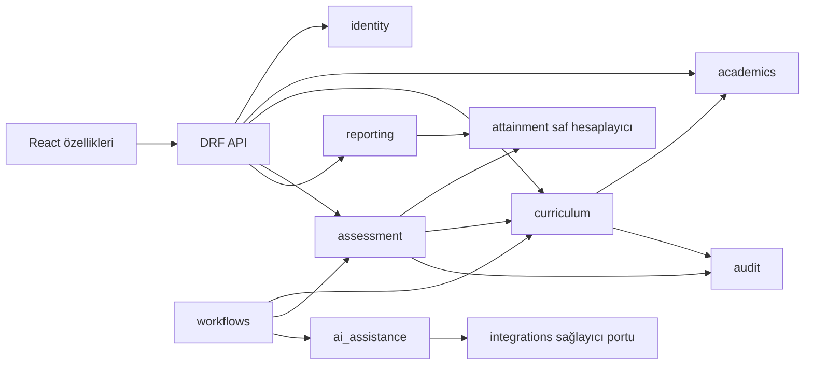
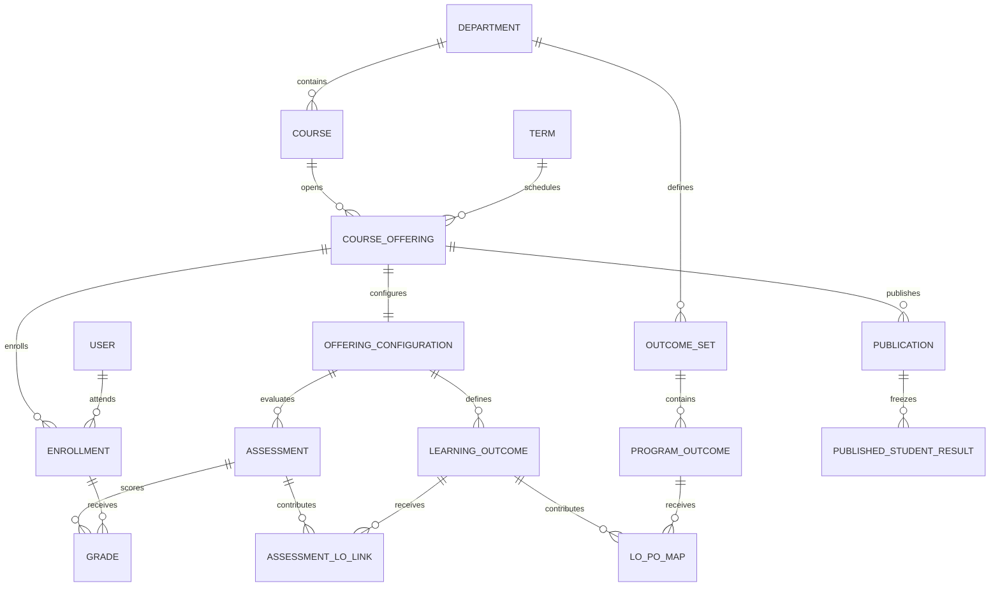

# Modüler mimari ve veri modeli

## Mimari seçim

Qualt, iş alanı başına bir Django uygulaması olan modüler monolit olarak geliştirilir. Her uygulama kendi model, servis, API, test ve migration'ına sahiptir. Frontend aynı alanlar etrafında ayrılır. Böylece özellikler ayrı branch'lerde geliştirilebilir; entegrasyon ortak sözleşmelere dayanır.

Bu yapı bağımsız **geliştirme ve test** sağlar. Her modülün bağımsız **üretim dağıtımı** ilk sürüm hedefi değildir. Dört kişilik ekipte ayrı mikroservisler; ağ hataları, dağıtık transaction, kimlik doğrulama ve çoklu deployment yükü yaratır. İlk teslimde tek Django release'i, tek PostgreSQL ve gerektiğinde aynı backend imajını kullanan worker yeterlidir. İleride önce dosya işleme/AI servisi ayrılabilecek biçimde dış sağlayıcı arayüzü korunur.

## Teknoloji kararı

| Katman | Önerilen araç | Projedeki somut kullanım |
| --- | --- | --- |
| Backend | Python 3.12, Django 5.2 LTS, Django REST Framework | İş kuralları, ORM, yetki ve REST API |
| Veritabanı | PostgreSQL 17'nin güncel güvenlik/bakım sürümü | İlişkiler, constraint, transaction, sorgu ölçümü |
| Sözleşme | OpenAPI 3.0, drf-spectacular | Endpoint şeması ve frontend tip üretimi |
| Frontend | React, TypeScript strict, Vite, Node.js 24 LTS | Ayrı geliştirilen web arayüzü; üretimde statik build |
| UI | MUI Community, ortak tema | Form, tablo, dialog ve erişilebilir temel bileşenler |
| Veri ve formlar | TanStack Query, React Hook Form, Zod | Sunucu verisi, doğrulama, hata yönetimi |
| Yönlendirme | React Router | Rol ve özellik bazlı ekranlar |
| Grafik | Recharts | PO profili, dağılım ve karşılaştırma; yanında veri tablosu |
| Mock API | MSW | Backend olmadan sözleşmeye uygun frontend geliştirme |
| Backend test | pytest, pytest-django, factory_boy | Hesap, yetki, transaction ve API testleri |
| Frontend test | Vitest, Testing Library, Playwright | Etkileşim, hata durumları ve gerçek sistem E2E |
| Kod kalitesi | Ruff, ESLint, Prettier, TypeScript kontrolü | Tek stil ve otomatik temel kontroller |
| Paket kilidi | uv.lock ve pnpm-lock.yaml | Geliştirici/CI/container ortamında aynı bağımlılıklar |
| Tasarım | Figma | Akış, komponent, prototip ve tasarım incelemesi |
| Operasyon | Docker, Compose, Gunicorn, Caddy | Tek VPS kurulumu, reverse proxy ve HTTPS |
| Uzun işler | Celery ve Redis, MVP 4'ten itibaren | AI extraction ve uzun rapor işleri |
| İş takibi | GitHub Issues, Projects, Actions | Backlog, PR inceleme, test ve release |

Sürüm aileleri başlangıç tercihidir; en güncel yamalar MVP 0'da birlikte kurularak lock dosyalarına sabitlenir. Django 5.2'nin LTS desteği ve DRF uyumu resmi kaynaklarda yer alır: [Django destek tablosu](https://www.djangoproject.com/download/), [DRF gereksinimleri](https://www.django-rest-framework.org/). [PostgreSQL destek politikası](https://www.postgresql.org/support/versioning/) ve [Node.js LTS tablosu](https://nodejs.org/en/about/previous-releases) sürüm seçiminin dayanağıdır. Tablodaki diğer araçlar ekip tasarım tercihidir.

React, Docker ve Figma hocanın açık zorunluluğu olarak sunulmaz. Araçların değeri, bu projede çözdükleri sorun ve ürettikleri kanıtla anlatılır. MUI'nin ücretli özellikleri başlangıç bağımlılığı yapılmaz; not çizelgesinin ihtiyacı Community bileşenleriyle prototiplenir.

## Servis sahipliği

| Servis | Backend sahibi | Sağladığı iş | Frontend karşılığı ve sahibi |
| --- | --- | --- | --- |
| identity | Murat Emre | Kullanıcı, session, kapsamlı rol ve atama kontrolü | auth, app shell — Onur Ege |
| academics | Murat Emre | Bölüm, dönem, ders, açılış, öğrenci kaydı | academic-admin — Onur Ege |
| curriculum | Murat Emre | PO seti, LO, sürümlü syllabus ve kopyalama | template-builder — Onur Ege |
| assessment | Poyraz | Değerlendirme, matrisler, notlar, CSV, yayımlama | gradebook — Mehmet Ali; matris editörü — Onur Ege |
| attainment | Poyraz | Not → LO → ders PO → program PO hesapları | student-profile ve açıklama — Mehmet Ali |
| reporting | Poyraz | Sınıf/bölüm analitiği ve dışa aktarma | analytics ve rapor — Mehmet Ali |
| integrations | Murat Emre | Güvenli dosya, job, sağlayıcı adapter, kota ve timeout | upload/review — Onur Ege |
| ai_assistance | Poyraz | Syllabus çıkarım şeması, kanıtlı öneri ve kalite ölçümü | AI taslak ekranı — Onur Ege; özet — Mehmet Ali |
| audit | Murat Emre | Kim, neyi, ne zaman, hangi gerekçeyle değiştirdi | Gerekçeli işlem dialogları — ilgili frontend sahibi |
| workflows | Murat Emre; Poyraz kendi servislerini sağlar | Birden fazla modülü bağlayan iş akışları; kendi tablosu yok | İlgili özelliğin frontend sahibi |

Her satırda tek birincil sahip vardır; aynı uzmanlık alanındaki diğer kişi reviewer ve yedektir. Hesaplama veya sözleşme değişikliği frontend tüketicisiyle de incelenir. Frontend sahipliği API'nin backend sahipliğini değiştirmez.

## Önerilen depo düzeni

Bu ağaç ileride proje deposuna uygulanacak yapıdır; mevcut klasörler olarak düşünülmemelidir.

```text
backend/
  config/                 settings, urls, WSGI
  apps/
    identity/
    academics/
    curriculum/
    assessment/
    attainment/
    reporting/
    integrations/
    ai_assistance/
    audit/
    workflows/             yalnızca modülleri birleştiren iş akışları
  common/                 yalnızca genel hata, ID ve zaman yardımcıları
frontend/
  src/
    app/                  router, provider, shell
    features/
      auth/ academic-admin/ template-builder/
      gradebook/ student-profile/ analytics/ ai-review/
    shared/               ui, api-client, generated-types
    mocks/                MSW handler ve senaryolar
contracts/
  openapi.yaml
  examples/
infra/
  docker/ compose/ caddy/ scripts/
docs/
  adr/ architecture/ api/ sprints/ evidence/ runbooks/
.github/
  workflows/ ISSUE_TEMPLATE/ PULL_REQUEST_TEMPLATE.md
```

Her backend uygulamasında `models.py`, `services/`, `selectors.py`, `api/serializers.py`, `api/views.py`, `api/urls.py`, `tests/` ve `migrations/` bulunur. Küçük dosyalar gereksiz yere çok sayıda katmana bölünmez. `services` iş akışını ve yazmayı, `selectors` kapsamlı okumayı, `api` HTTP dönüşümünü üstlenir.

## Modüller arası sözleşmeler



`attainment` hesaplayıcısı Django modeline veya HTTP'ye bağımlı olmaz. Python veri sınıflarıyla `ScoreInput`, `MappingInput`, `PolicyInput` alır; `ScoreResult` döndürür. Böylece Poyraz, Murat'ın akademik CRUD'u tamamlanmadan örnek verilerle hesapları bitirebilir.

| Sağlayıcı | İç arayüz taslağı | Tüketici | Bağımsız test alternatifi |
| --- | --- | --- | --- |
| academics | `get_offering_context(actor, offering_id)` | curriculum, assessment | Bölüm/öğretmen/kayıt bilgili fixture |
| curriculum | `get_curriculum_context(actor, offering_id)` | assessment, workflows | İki LO ve PO setini taşıyan sabit DTO |
| workflows | `get_configuration_snapshot(actor, offering_id)` | API ve yayın önizlemesi | Curriculum ve assessment DTO'larının birleştirilmiş örneği |
| assessment | `get_published_evidence(actor, student_id, scope)` | reporting | Yayımlanmış kanıt listesi |
| attainment | `calculate_course(input, policy)` ve `aggregate_program(inputs, policy)` | assessment, reporting | Saf fonksiyon, DB gerekmez |
| integrations | `extract_document(file_id)` ve `generate_structured(schema, text)` | ai_assistance | Başarılı/hatalı/timeout fake provider |
| audit | `record_event(actor, action, entity, changes, request_id)` | Yazma servisleri | Transaction içinde doğrulanan kayıt |

Başka modülün tablosuna rastgele yazılmaz; sahibinin servis fonksiyonu çağrılır. Aynı backend sürecinde modüller birbirine HTTP isteği atmaz. Okuma için başka modülün public selector/DTO'su kullanılır. Yabancı anahtarlar modülerlik adına kaldırılmaz; ilişkisel bütünlük korunur. Döngüsel import oluşuyorsa sınır yeniden ele alınır.

Frontend özellikleri birbirinin iç dosyalarını import etmez; ortak bileşen `shared` altında, açık export üzerinden kullanılır. Tüm HTTP erişimi tek istemciden geçer. Sunucu state'i Query'de, yerel form state'i formda tutulur; aynı verinin üç ayrı kopyası yönetilmez.

### Bir servis ayrı geliştirilirken gereken en küçük ortam

Her servis kendi README'sinde public arayüzünü, ihtiyaç duyduğu kimlikleri, fixture'ını, endpointlerini ve test komutunu açıklar. Hesaplayıcı saf Python testleriyle, AI servisi fake provider ile, frontend özellikleri MSW ile tek başına ilerler. ORM kullanan modüllerde ortak test PostgreSQL'i ve gerekli temel migration'lar kurulur; başka modülün tamamlanmış kullanıcı arayüzü veya çalışan dış sağlayıcısı gerekmez. Bu bağımsız geliştirmedir; her modülün tüm veritabanı ilişkilerinden bağımsız olduğu iddia edilmez.

Örnek alan komutları: backend dizininde `uv run pytest apps/assessment/tests`, frontend dizininde `pnpm vitest run src/features/gradebook`. Ortak fixture'lar yalnız sahte kimlik/DTO ve minimum kayıt sağlar; diğer modülün iş kuralının ikinci bir kopyasını içermez. CI alan testinden sonra birleşik integration testini çalıştırır.

## Veri modeli

| Varlık | Temel alanlar ve ilişkiler | Sahip |
| --- | --- | --- |
| User | UUID, email, display_name, optional unique student_number, is_active; ilk migration'dan özel kullanıcı modeli | identity |
| DepartmentMembership | user, department, role; unique üçlü | identity |
| Department | code, name | academics |
| Term | code, start_date, end_date; başlangıç < bitiş | academics |
| Course | department, code, title, default_local_credit, default_ects, revision | academics |
| CourseOffering | course, term, section, kredi/AKTS kopyası, revision | academics |
| TeachingAssignment | offering, instructor; unique çift | academics |
| Enrollment | offering, student, status, attempt_no; unique offering/student | academics |
| OutcomeSet | department, version, status, effective_from | curriculum |
| ProgramOutcome | outcome_set, code, description; unique set/code | curriculum |
| SyllabusTemplateVersion | template_key, version, source, immutable payload | curriculum |
| OfferingConfiguration | offering, template_version, outcome_set, revision, status | curriculum |
| LearningOutcome | configuration, code, description | curriculum |
| Assessment | configuration, code, kind, max_score, grade_weight, due_at | assessment |
| AssessmentLOLink | assessment, learning_outcome, weight; unique çift | assessment |
| LOPOMap | learning_outcome, program_outcome, weight; unique çift | assessment |
| CoursePOContribution | configuration, program_outcome, weight_1_to_5 | assessment |
| Grade | assessment, enrollment, raw_score, state, revision; unique çift | assessment |
| Publication | offering, source_revision, policy_version, stage, actor, immutable input/output snapshot | assessment |
| OfferingPublicationState | offering one-to-one, active_publication; aktif yayın işaretçisi | assessment |
| PublishedStudentResult | publication, enrollment, LO/PO sonuçları ve coverage; saf hesaplayıcının kalıcı çıktısı | assessment |
| ImportBatch | offering, owner, hash, preview, base_revision, status, expires_at | assessment |
| FileAsset | owner, scope, storage_key, detected_type, size, retention_until | integrations |
| Job | owner, type, state, input_ref, attempts, result_ref, expires_at | integrations |
| AIProposal | job, offering, base_revision, structured_draft, evidence, status | ai_assistance |
| ReportArtifact | owner, scope, filters, publication_refs, status, storage_key, expires_at | reporting |
| AuditEvent | actor, scope, action, entity, reason, diff, request_id, time | audit |

Yukarıdaki tablo kavramsal sözleşmedir; migration tasarımı sırasında sahipler indeks ve alan tiplerini kesinleştirir. `PublishedStudentResult` yalnızca yayımlanmış, tekrar üretilebilir sonucu taşır; kaynak notun yerine geçmez. JSON yalnızca değişmez snapshot, AI taslağı ve ham entegrasyon kanıtında kullanılır. Ders, kayıt, not ve ilişkiler normalleştirilmiş tablolardır.



## Bütünlük ve eşzamanlılık

İlk sürüm PostgreSQL Read Committed ile başlar. Not toplu güncelleme, konfigürasyon değiştirme ve yayımlama servisleri aynı ders açılışı satırını `select_for_update()` ile kilitler, `expected_revision` değerini karşılaştırır ve tek transaction içinde revision artırır. Bu kuralı bütün yazma yolları izlemelidir; admin, CSV ve AI kabul akışı da buna dahildir.

Sadece `transaction.atomic()` kullanmak eşzamanlı veri kaybını önlemeye yetmez. Kilit + sürüm kontrolü eski ekrana yazma için 409 döndürür. Bulk işlemde geçersiz tek satır varsa hiçbir not değişmez. Kilit tutulurken dış AI API çağrısı yapılmaz. İş kuyruğu DB'de kalıcı Job kaydı üzerinden, commit sonrası gönderilir; gönderim başarısızlığını yeniden tarayan mekanizma iş kaybını önler. [Django transaction belgesi](https://docs.djangoproject.com/en/5.2/topics/db/transactions/)

Not ve maksimum puan sınırı, değerlendirme/kayıt dersinin aynı olması, LO/PO'nun aynı konfigürasyon/set kapsamında olması servis doğrulamasında kontrol edilir. Tek sütun constraint'iyle çapraz tablo kuralı çözüldüğü iddia edilmez. Uygun unique/check/FK kısıtları veritabanında ayrıca bulunur.

## Kimlik doğrulama ve ağ

Frontend ve API aynı origin'de sunulur: `/` statik web, `/api/v1/` Django. Django session cookie `HttpOnly`, `Secure`, `SameSite=Lax` olur. CSRF token başlangıç endpointinden alınır; login dahil tüm güvenli olmayan isteklere `X-CSRFToken` eklenir. Geliştirmede Vite proxy kullanılır. Böylece tarayıcı token saklama ve gereksiz CORS yapılandırması azaltılır. SessionAuthentication'ın CSRF ve yanıt davranışı sözleşmede sabitlenir. [DRF kimlik doğrulama](https://www.django-rest-framework.org/api-guide/authentication/)

## AI sınırı

AI yalnızca taslak üretir. Notları, yayımlanmış sonuçları ve resmi PO setini otomatik değiştiremez. Kullanıcı dosyası veri olarak işlenir; dosyanın içindeki talimatlar uygulama komutu sayılmaz. Model çıktısı şemadan, akademik kurallardan ve yetki kontrolünden geçer. Öğretim elemanı alan bazında düzeltir ve açık kabul işlemi yapar. Kabul, normal curriculum/assessment servislerini çağırır.

Murat sağlayıcı adapter, dosya, retry ve bütçe sınırını; Poyraz çıkarım şemasını, öneri iş akışını ve kalite ölçümünü geliştirir. Birbirlerinden bağımsız çalışabilmeleri için fake provider ilk aşamada hazırlanır. Harici AI kapalıyken manuel şablon, not ve PO hesapları tamamen çalışır.
