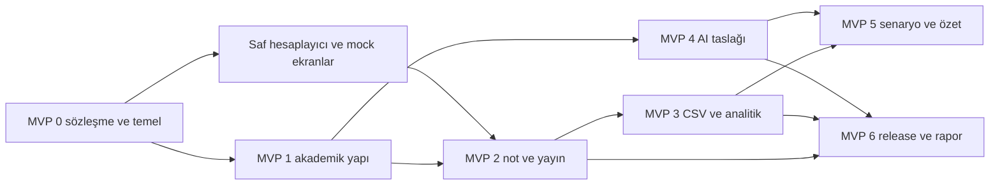

# MVP iş paketleri ve teslim takvimi

## MVP adlandırması

İş paketi bir sorumluluk kümesidir; MVP ise kullanıcıya baştan sona değer sunan en küçük çalışan üründür. Bu planda iletişim kolaylığı için MVP 0–6 numaraları kullanılır. **İlk gerçek kullanılabilir MVP, MVP 2'nin sonunda oluşur.** MVP 0 temel hazırlık, MVP 1 yapılandırma dilimidir. Sonraki aşamalar bu ürünü genişletir.

Her aşama backend + frontend + test + tasarım + süreç kanıtını içerir. Backend bitip frontend başlamaz; iki taraf sözleşme üzerinden paralel çalışır. Bir özellik haftalarca ayrı branch'te tutulmaz. Küçük PR'larla `main` üzerinde birleşir; tamamlanmayan ekran gerekirse feature flag ile kapalıdır.

## MVP 0 Geliştirilebilir ortak temel

**Hedef:** Herkesin kendi alanını çalıştırabildiği, login örneğinin gerçek API'ye bağlandığı ve ilk PR'ın CI'dan geçtiği ortam.

**İşler:** depo yapısı; Django/DRF/PostgreSQL; React/TypeScript; session/CSRF; tasarım tokenları; ortak API istemcisi; mock örnekleri; GitHub Projects alanları; issue/PR şablonları; ilk lint/test/build; yerel Docker Compose.

**Kişi işleri:** M-001/002, P-001/002, O-001/002, A-001/002. Herkeste 8 puan.

**Kabul:** temiz clone'dan belgelenmiş komutlarla kurulum; dört test hesabı; backend kapalıyken örnek frontend ekranı; backend açıkken gerçek login; CI en az bir hata yakalayıp düzeltmeden sonra yeşil; her kişinin bir branch ve review edilmiş PR'ı.

**Bağımlılık:** dış servis gerektirmez. AI için fake adapter yeterlidir. **Demo:** giriş → role uygun boş ana ekran → API hatası → düzeltilmiş durum. **Kanıt:** kurulum kaydı, Figma v0, ilk PR/CI bağlantıları.

## MVP 1 Akademik yapı ve interaktif şablon

**Hedef:** Bölüm yöneticisi ders açar ve öğretmen şablondan öğrenme çıktıları oluşturur.

**İşler:** bölüm ve dönem; ders kataloğu; kredi/AKTS; ders açılışı ve öğretmen ataması; öğrenci kaydı; 11 PO'lu pilot set; LO editörü; şablon listeleme/kopyalama; değerlendirme ve matris UI iskeleti. Not ekranı ve hesaplama tarafı fixture ile paralel hazırlanır.

**Kişi işleri:** M-003/004=13; P-003/004=5; O-003/004=13; A-003/004=5.

**Kabul:** aynı ders farklı dönemde ayrı açılır; şablon kopyası kaynak şablonu değiştirmez; bölüm dışı yönetim reddedilir; öğrencinin hangi açılışa kayıtlı olduğu kesindir; kredi ve AKTS ayrı görünür. **Demo:** yönetici açılış oluşturur → öğretmen şablonu kopyalar → bir LO metnini değiştirir. **Kanıt:** ER taslağı, Figma prototipi, yetki testleri.

## MVP 2 Notlardan öğrenci PO profiline

**Hedef:** Kullanıcı zincirinin ilk uçtan uca teslimi.

**İşler:** değerlendirmeler; ders genel not yüzdeleri; assessment–LO ve LO–PO matrisleri; 1–5 ders katkıları; klavyeyle not girişi; atomik kaydetme; hesap önizlemesi; provisional/final yayın; öğrenci not/LO/PO ekranı; hesaplamanın açıklaması.

**Kişi işleri:** M-005/006=8; P-005/006=13; O-005/006=8; A-005/006=13.

**Kabul:** hocanın 90/80 örneği doğru; 1.4 ağırlık toplamı geçerli; sıfır ile eksik ayrılır; başka öğrencinin sonucu görülemez; öğrenci taslak notu göremez; 409 çakışması veri kaybettirmeden çözülür; mock kapalı gerçek E2E geçer.

**Demo:** öğretmen 90 ve 80 girer → LO1 86.0/LO2 82.9 önizlemesi → PO1 85.0/PO2 82.9 yayını → öğrenci kendi ekranında kaynağı açar. **Kanıt:** hesap testi, gerçek API kaydı, iki rol E2E videosu.

## MVP 3 Toplu veri ve bölüm analitiği

**Hedef:** Sistem küçük bir sınıfın günlük işi için kullanılabilir hale gelir.

**İşler:** CSV önizleme ve commit; tekrar dersi/tarih kesiti; bölüm ve ders dashboard'u; kapsam ve örneklem; yayımlama geçmişi; gerekçeli yeniden açma; audit görünümü; CSV raporu; indeks ve sorgu ölçümü.

**Kişi işleri:** M-007/008=8; P-007/008=13; O-007/008=5; A-007/008=8.

**Kabul:** geçersiz CSV satırında veri değişmez; aynı commit iki kez uygulanmaz; dönem filtresi bütün kart ve grafiklerde tutarlı; boş PO sıfır gibi çizilmez; tekrar ders iki defa sayılmaz; rapor ile ekran aynı yayınları kullanır.

**Demo:** 50 öğrencilik sentetik CSV → hatalı satırı göster → düzelt ve aktar → yayımla → bölüm profilini aç → raporu indir. **Kanıt:** import testleri, audit kaydı, sorgu planları ve basit yük ölçümü.

## MVP 4 Syllabus dosyasından denetlenebilir AI taslağı

**Hedef:** Öğretim elemanı bir syllabus'tan ders yapılandırmasını daha az elle girişle hazırlayabilir.

**İşler:** PDF yükleme; güvenli saklama; metin çıkarma; Celery/Redis job; sağlayıcı adapter; sınırlı retry/timeout/kota; şemalı çıkarım; alan bazında kaynak sayfa ve alıntı; taslak düzenleme; açık kabul; manuel alternatif.

**Kişi işleri:** M-009/010=8; P-009/010=8; O-009/010=13; A-009/010=8.

**Kabul:** gerçek örnek syllabus'tan LO ve değerlendirmeler çıkarılır; yoktan not veya PO metni üretilip kaydedilmez; düşük güvenli alanlar işaretlenir; hatalı ağırlık kabulü engellenir; servis kapalıyken temel ürün çalışır; kabul edilen alanlar normal servis doğrulamasından geçer.

**Ölçüm:** lisanslı/paylaşılması uygun en az 10 syllabus veya sentetik eşdeğerinden küçük değerlendirme seti; alan doğruluğu, düzeltme sayısı, süre ve istek maliyeti kaydedilir. Hedef ≥%90 alan doğruluğu başlangıç hedefidir, ölçülmüş sonuç değildir. Çıkmazsa kapsam birkaç alanla daraltılır.

**Demo:** PDF → taslak → kaynağı göster → yanlış alanı insan düzeltir → taslağa uygula. **Kanıt:** karşılaştırmalı kalite tablosu, hata/timeout demosu, provider stub testi.

## MVP 5 Açıklanabilir gelişim ve senaryo ekranları

**Hedef:** Kullanıcı puanın nedenini ve olası değişimini anlayabilir.

**İşler:** “Bu not şu olsaydı?” simülasyonu; gerçek kaydı değiştirmeyen sonuç karşılaştırması; yayımlanmış sayılara dayalı AI performans özeti; kaynak bağlantıları; erişilebilir grafik/tablo; akışların kullanılabilirlik iyileştirmesi.

**Kişi işleri:** M-011/012=5; P-011/012=5; O-011/012=5; A-011/012=10.

**Kabul:** simülasyon kalıcı nota dokunmaz; kullanıcı yalnız kendi/atanmış kapsamı kullanır; AI özeti sayısal değerleri uydurmaz; kaynak gösterilemeyen yorum yayımlanmaz; görsel ve metinsel sonuç eşleşir.

Bu aşama kapasite aşılırsa önce çıkarılır. Sayısal açıklama MVP 2'nin çekirdeğidir; çıkarılan şey ek simülasyon ve AI anlatımıdır. Kesinti kararı issue ve sprint kaydında gerekçelendirilir.

## MVP 6 VPS release ve ders teslimi

**Hedef:** Tekrarlanabilir dağıtım, kurtarma ve sunum.

**İşler:** production containerlar; HTTPS; secret yönetimi; migration adımı; smoke test; log ve health; PostgreSQL/upload yedeği; ayrı ortamda restore; eski imaja rollback; performans ve yetki regresyonu; iki ayrı altı bölümlü rapor; final prova.

**Kişi işleri:** M-013/014=10; P-013/014=8; O-013/014=8; A-013/014=8.

**Kabul:** temiz hedefte belgelenmiş kurulum; prod ayar kontrolleri; yedekten geri yüklenmiş örnek sonuç; gerçek API'yle frontend; demo verisi; arıza halinde yerel Docker yedek demo; basılı raporlar ve kaynak bağlantıları.

MVP 6 hazırlığı MVP 0'da başlar; Docker/CI/report işi son haftaya bırakılmaz. Son aşama bir araya getirip kanıtlama aşamasıdır.

## Efor matrisi

| Aşama | Murat Emre | Poyraz | Onur Ege | Mehmet Ali | Toplam |
| --- | ---: | ---: | ---: | ---: | ---: |
| MVP 0 | 8 | 8 | 8 | 8 | 32 |
| MVP 1 | 13 | 5 | 13 | 5 | 36 |
| MVP 2 | 8 | 13 | 8 | 13 | 42 |
| MVP 3 | 8 | 13 | 5 | 8 | 34 |
| MVP 4 | 8 | 8 | 13 | 8 | 37 |
| MVP 5 | 5 | 5 | 5 | 10 | 25 |
| MVP 6 | 10 | 8 | 8 | 8 | 34 |
| **Toplam** | **60** | **60** | **60** | **60** | **240** |

Puanlar görev başına 2/3/5/8 gibi göreli büyüklüklerdir; satırlarda iki görevin toplamı bulunur. Bir kişinin erken aşama yükü yüksekken diğerinin sonraki aşama yükü yükselir. Puan eşitliği tek başına yeterli değildir: inceleme, engel çözümü, araştırma ve operasyon yükü sprintte ayrıca kaydedilir. Her hafta gerçek kalan iş ve ekip kapasitesine göre yeniden plan yapılır.

## Tarihli sprint planı

| Sprint | Tarih 2026 | Ürün hedefi | Süreç ve ders kanıtı |
| --- | --- | --- | --- |
| S0 | 21–25 Ekim | MVP 0 | Board, Figma, ilk sözleşme, ilk PR/CI |
| S1 | 26 Ekim–1 Kasım | MVP 1 | ER, tasarım review, kod review kayıtları |
| S2 | 2–8 Kasım | MVP 2 | Uçtan uca demo, formül testleri, mimari freeze |
| S3 | 9–15 Kasım | Düzeltme ve küçük MVP 3 işleri | 10 Kasım sınav; 12 Kasım CSE 321 sunum/rapor |
| S4 | 16–22 Kasım | MVP 3 altyapısı, düşük kapsam | 17 Kasım CSE 311 sunum/rapor; 19 Kasım sınav |
| S5 | 23–29 Kasım | MVP 3 tamamlanır | Veri ölçümü, CSV, audit ve review kanıtı |
| S6 | 30 Kasım–6 Aralık | MVP 4 | AI doğruluk ölçümü, worker hata senaryosu |
| S7 | 7–13 Aralık | MVP 5 veya kaliteye ayrılan süre | Kapsam kapatma kararı; yeni özellikler 13 Aralık'ta biter |
| S8 | 14–20 Aralık | MVP 6 ve release adayı | Restore, rollback, rapor taslağı ve demo prova |
| S9 | 21–28 Aralık | Hata düzeltme ve teslim tamponu | 22/24 Aralık sınav; basım ve son prova |
| Final | 29–30 Aralık | Canlı demo | İki ders için basılı rapor |

Bu takvim saat taahhüdü değildir. İlk gerçek velocity S0/S1 sonunda ölçülür. 8 Kasım'da bütün akış tamamlanmıyorsa ilk kesinti AI/özel görsel ayrıntılar ve gelişmiş filtrelerdir; yetki, formül doğruluğu ve yayımlama kuralı kesilmez. Sunumda tamamlanmamış işler açıkça backlog olarak gösterilir.

## Entegrasyon sırası

Oklar entegrasyon bağımlılığıdır; frontend'in başlamasını engellemez. Örneğin Mehmet Ali sonuç ekranını Poyraz'ın Result DTO'suyla, Onur şablon editörünü Murat'ın Configuration DTO'suyla ilk haftalarda kurabilir. AI provider çalışmadan AI review ekranının bütün durumları MSW ile denenebilir.
