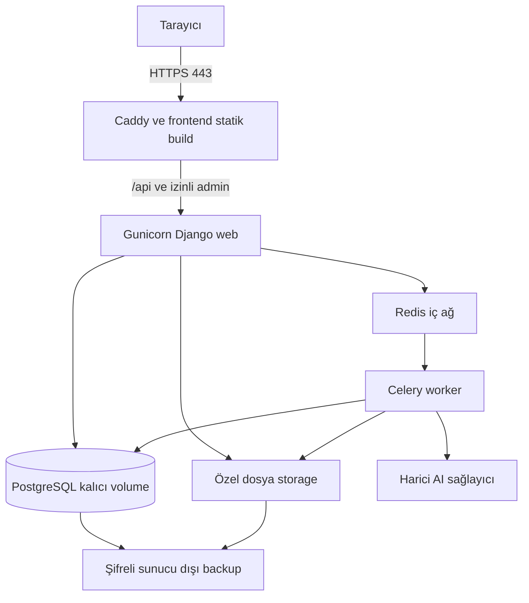
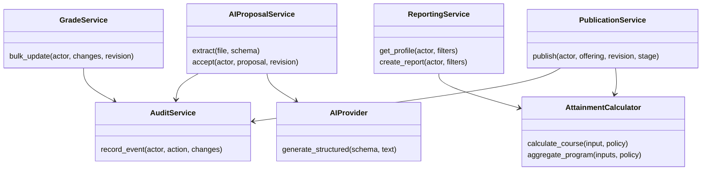

# Kalite güvencesi VPS ve ders raporları

## Kalite hedefleri

Endüstri pratiğini kullanılan araç sayısıyla değil; doğru sonuç, açık sahiplik, kontrollü değişiklik, tekrarlanabilir kurulum ve kurtarılabilir veriyle gösterin. Aşağıdaki sayısal hedefler başlangıç hedefidir; proje için ölçülmüş sonuç değildir.

| Alan | Release kabul ölçütü | Kanıt sahibi |
| --- | --- | --- |
| Hesap doğruluğu | Hocanın örneği ve kritik uç durumlar geçer | Poyraz |
| Yetki | Her API ailesinde kapsam dışı okuma/yazma reddedilir | Murat + Poyraz |
| Veri tutarlılığı | Bulk ve publish yarış testleri veri kaybetmez | Poyraz; Murat review |
| Frontend | Loading/empty/error/forbidden/conflict akışları çalışır | İlgili frontend sahibi |
| Sözleşme | Şema, fixture, frontend tipleri ve gerçek yanıt uyumlu | İki alan sahibi |
| E2E | Gerçek backend ile kritik kullanıcı zinciri geçer | Mehmet; Onur kendi akışları |
| Performans | Test veri setinde interaktif API p95 <500 ms; rapor <3 s hedefi | Poyraz |
| Erişilebilirlik | Temel akış klavyeyle; grafiklerin tablo karşılığı var | Onur + Mehmet |
| AI | Yanlış/kanıtsız alan otomatik uygulanmaz; manuel yol çalışır | Murat + Poyraz + Onur |
| Kurtarma | Ayrı ortamda DB ve dosya restore sonrası smoke başarılı | Murat + Poyraz |

Performans hedefi dosya/AI işlemlerini kapsamaz; bunlar asenkron job olarak ölçülür. Başlangıç yük senaryosu: 1.000 sentetik öğrenci, 30 ders açılışı, açılış başına ortalama 100 kayıt ve 5 değerlendirme, yaklaşık 15.000 not hücresi, 20 eşzamanlı kullanıcı. Donanım, veri hacmi, concurrency, hata oranı, p50/p95 ve sorgu sayısı birlikte raporlanır. Hedef tutmazsa ölçüm sonrası dar boğaz giderilir veya hedef gerekçeyle güncellenir.

## Test katmanları ve sorumluluk

**Saf domain testleri:** Poyraz normalizasyon, ağırlık, sıfır payda, missing/excused, tekrar ders ve tarih kesitini test eder. UI testinde aynı formül tekrar yazılıp hesap motorunun kopyası test edilmez.

**Backend servis/API testleri:** Her backend sahibi kendi yazma ve scope kuralını test eder. PostgreSQL constraint, transaction rollback, revision yarışı ve idempotency gerçek veritabanında doğrulanır. Başka dersten assessment/enrollment ID'si gönderen istekler de test edilir.

**Frontend component testleri:** Onur şablon/auth, Mehmet gradebook/analitik davranışını test eder. Kullanıcı eylemi, doğru alan hatası, iptal, yeniden deneme ve kaydedilmemiş veri korunması önemlidir; yalnız implementation detayını tekrar eden snapshot testleriyle yetinilmez.

**Contract testleri:** Her endpoint dilimi örnek yanıtlarıyla doğrulanır. Enum, null, decimal, pagination ve error shape değişikliği yakalanır. OpenAPI şemasının geçerli olması tek başına yetki veya hesap doğruluğunu kanıtlamaz.

**E2E:** Gerçek API/PostgreSQL ile öğretmen not→yayın→öğrenci profili; yönetici ders/şablon; CSV import; AI fake provider→kabul→şablon akışları. MSW geliştirme/component testinde yararlıdır; gerçek backend E2E sırasında kapalıdır.

**Migration testleri:** Temiz DB üzerinde tüm migration'lar ve önceki release veritabanı üzerinde yeni migration çalışır. Alan silme veya yeniden adlandırma veriyi kaybetmemeli. En az bir gerçek sürüm yükseltme örneği raporda gösterilir.

Kritik hesap/yetki dalları için yüksek kapsam hedeflenir; tek bir yüzdelik coverage ürün kalitesi sayılmaz. Boş veya anlamsız testlerle oran yükseltilmez.

## Docker ve VPS topolojisi



MVP 0–3 için Caddy/frontend, Django ve PostgreSQL yeterlidir. Redis/worker MVP 4'te gelir. Frontend için üretimde Node geliştirme sunucusu gerekmez. Web ve worker aynı backend imajını farklı komutlarla çalıştırır.

Yerel ortamda kod mount ve hot reload; production'da commit SHA/digest ile sabitlenmiş imajlar kullanılır. Aynı ana PostgreSQL sürümü development, CI ve VPS'te korunur. Container yeniden yaratılınca veri kaybolmamalı; DB, private upload ve Caddy sertifika verileri kalıcıdır. [Docker Compose üretim rehberi](https://docs.docker.com/compose/how-tos/production/)

Tek VPS bir hata noktasıdır. Ayrı container kullanmak yüksek erişilebilirlik sağlamaz. İlk dönem hedefi anlaşılır deploy ve doğrulanmış kurtarmadır; Kubernetes, servis mesh, çok bölgeli DB veya Kafka zorunlu değildir.

## Production ayarları

- `DEBUG=False`, doğru `ALLOWED_HOSTS`, doğru trusted origin/proxy ayarı ve gerçek HTTPS.
- Session cookie Secure/HttpOnly; CSRF cookie ve login koruması; uygun SameSite.
- Üretim `SECRET_KEY`, DB parolası ve AI anahtarı kaynak koddan ayrı; secret erişimi sınırlı.
- PostgreSQL ve Redis internete publish edilmez; iç ağdan erişilir. SSH anahtar ve firewall kullanılır.
- Caddy upload boyutu ile backend sınırı tutarlı; özel dosya download yetki kontrolüyle yapılır.
- Django admin yalnız yetkili teknik kullanıcılar içindir; iş kullanıcılarının normal arayüzünün yerine geçmez.
- Loglarda request ID, status, süre ve hata kodu bulunur; parola, session, API key ve tam öğrenci not listesi yazılmaz.
- Login, upload ve AI uçlarında hız/kota sınırı; frontend'e secret içeren build değişkeni verilmez.
- Production build ve servisler için `manage.py check --deploy` sonucu incelenir; gerekli uyarılar gerekçelendirilir.

Bu ayarlar Django'nun resmi [deployment kontrol listesiyle](https://docs.djangoproject.com/en/5.2/howto/deployment/checklist/) karşılaştırılır. `runserver` üretim sunucusu olarak kullanılmaz.

## Deploy ve geri dönüş akışı

1. Review edilmiş `main` commit'i ve geçen CI seçilir; release notunda değişiklik ve migration etkisi yazılır.
2. Backend/frontend imajları aynı kaynak sürümüne bağlanır. İmajlar bir kez build edilir; staging ve production aynı imajı kullanır.
3. Staging'de migration, smoke ve gerçek UI E2E yapılır. Production onay kapısı yalnız bu kanıttan sonra geçilir.
4. Production DB ve gerekli dosyaların yedeği alınır; kullanılabilir alan ve yedek sonucu kontrol edilir.
5. Tek bir release işlemi migration çalıştırır; her web worker başlangıcında yarışmalı migration yapılmaz.
6. Yeni containerlar başlatılır; readiness, login, ders listesi, örnek yayın sonucu ve frontend route smoke kontrolü yapılır.
7. Hata varsa yeni trafiği durdurup son uyumlu imaja dönülür; migration geri uyumlu değilse otomatik ters migration yapılmaz. Önceden hazırlanmış veri kurtarma planı izlenir.
8. Release tarihi, SHA, imaj digest, migration, smoke sonucu ve varsa incident notu kayıt altına alınır.

Şema değişimlerinde mümkün olduğunca ekle → kodu geçir → kullanımı kaldır sırası izlenir. Basit tek VPS Compose dağıtımı kısa kesinti içerebilir; test edilmemiş “sıfır kesinti” sözü verilmez.

## Backup ve restore

Başlangıç hedefi RPO ≤24 saat, RTO ≤2 saattir. Bunlar kaybedilebilecek veri aralığı ve geri dönüş süresi hedefleridir; restore provasıyla ölçülmeden garanti edilmez. Günlük DB dump ve özel dosya yedeği sunucu dışına şifreli taşınır; örnek saklama politikası 7 günlük + 4 haftalık kopyadır.

DB ve dosyalar birlikte kurtarılabilmelidir. İlk sürümde yedek sırasında dosya kabul/commit işlemlerini kısa süre dondurmak veya değişmez dosya anahtarları ve manifest kullanmak veri/dosya eşleşmesini kolaylaştırır. Şifreleme anahtarının erişilebilir kurtarma kopyası ayrı güvenli yerde bulunur.

Restore provası yeni boş veritabanına yapılır. Uygulama sürümü, şema, satır sayıları, örnek kullanıcı erişimi, dosya açılması ve PO sonucu kontrol edilir. Yedek dosyasının oluşması restore kanıtı değildir. Rapor ekran görüntüsü, checksum ve restore süresini içerir; secret/dump içeriği rapora konmaz.

## Hata senaryoları

| Olay | Kullanıcıya davranış | Sistem davranışı | Sorumlu |
| --- | --- | --- | --- |
| AI sağlayıcı yanıt vermiyor | Açık hata ve manuel şablon | Sınırlı retry, job failed, kota korunur | Murat + Poyraz |
| Worker yeniden başlıyor | Job bekliyor/yeniden deneniyor | Kalıcı job, idempotent işlem | Murat |
| Aynı nota iki kişi yazıyor | 409 ve karşılaştırma | Kilit + revision; sessiz overwrite yok | Poyraz + Mehmet |
| Dosya hatalı | Satır/alan hataları | Yazma yok, hata raporu | Poyraz + ilgili frontend |
| DB erişilemiyor | Geçici hizmet hatası | Readiness başarısız, log/uyarı | Murat |
| Rapor hazırlanamadı | Tekrar deneme ve kaynak ekran | Kaynak yayın korunur | Poyraz + Mehmet |
| VPS kaybı | Yerel demo veya kurtarma | Offsite backup'tan yeni host | Murat + Poyraz |

## CSE 311 raporu

[Report Format](../references/README.md#report-format) ve Guidelines s.17 altı bölüm ister. Bunlar final raporun başlıkları olmalıdır; bu plan tamamlanmış dönem raporu yerine geçmez.

| Bölüm | Yazılacak içerik | Gerçek kanıt | İlk taslak sahibi |
| --- | --- | --- | --- |
| 1 Punchline ve backlog | Ürünün temel faydası; backlog nasıl oluşturuldu/yönetildi | Board görüntüsü, issue ve Figma akışı | Onur |
| 2 İş bölümü ve velocity | Kim hangi işi yaptı; tahmin, sprint süresi, tamamlanan puanlar | Kişi/issue/PR matrisi, sprint tablosu | Mehmet; herkes kendi kaydını doğrular |
| 3 GitHub activity | Her üyenin katkı grafiği ve code frequency | Contributors ve Insights çıktıları, PR bağlantıları | Mehmet |
| 4 Branching | Feature branch, PR, merge ve conflict yöntemi | Gerçek PR/branch örnekleri | Murat |
| 5 CI ve CD | Kullanılan Actions YAML ve seçili run'ların açıklaması | Başarılı run, hata yakalama, release kaydı | Murat; frontend kısmı Onur |
| 6 Getting Real | Gerçekte uygulanan ilkeler ve bölüm referansları | İlke → karar → issue/PR örneği | Onur; herkes örnek verir |

Önerilen Getting Real bağlantıları, ancak gerçekten uygulandıysa raporda “uyguladık” diye yazılır:

| Bölüm | Projedeki olası karşılığı |
| --- | --- |
| Chapter 4 — Build Less | Tam OBS yerine PO çekirdeğini önce teslim etmek |
| Chapter 7 — Fix Time and Budget, Flex Scope | Demo tarihini koruyup MVP 5'i gerektiğinde çıkarmak |
| Chapter 29 — Race to Running Software | Erken uçtan uca login/not/yayın demosu |
| Chapter 46 — Interface First | Figma ve sözleşmeyle veri akışını koddan önce netleştirmek |
| Chapter 48 — Three State Solution | Boş, normal ve hatalı/istisnai ekran durumlarını tasarlamak |

Bölüm adları ve içerik için [Getting Real](https://basecamp.com/gettingreal) kullanılır. Bütün kitabı uyguladığınızı iddia etmek yerine somut karar seçin. AI ile yazılan kodu reviewer anlamalı, test etmeli ve açıklayabilmelidir; AI kullanımı bireysel katkının yerine geçmez.

## CSE 321 raporu

Guidelines s.18'deki ayrı altı bölüm kullanılır. CSE 311 raporunu aynı başlıklarla ikinci derse vermeyin.

| Bölüm | İçerik ve kanıt | İlk taslak sahibi |
| --- | --- | --- |
| 1 Introduction | PO sistemi, kullanıcılar ve değer sağlayan özellikler | Poyraz; dört kişi review |
| 2 System design | Web/API/DB/worker/dış servis mimarisi ve sınıf diyagramı | Murat; frontend sınırı Onur |
| 3 Data model | ER, ilişkiler, normalize model, gerçek tablo istatistikleri | Poyraz; Murat kendi tabloları |
| 4 Scalability and fault tolerance | Sorgu/indeks ölçümleri, cache ihtiyacı, backup, restore, tek VPS sınırı | Poyraz + Murat |
| 5 Consistency | Isolation level, transaction sınırı, kilit ve yarış testleri | Poyraz |
| 6 Teamwork | Hangi üyenin hangi gerçek işi yaptığı | Mehmet; herkes doğrular |

OLTP çekirdeği normalize ilişkisel modeldir. Analitik sorgu için hemen star/snowflake zorunluluğu yoktur; hangi modeli neden seçtiğinizi açıklayın. Materialized view, cube, partition ve replication kullanmadıysanız “uygulandı” yazmayın; mevcut ölçekte neden gerekmediğini ve hangi ölçümde ekleneceğini belirtin.

### Sınıf ve nesne taslağı

Bu diyagram davranış ilişkisini gösterir; gerçek sınıf adları uygulama sonunda güncellenir. ER diyagramı bunun yerine geçmez.



### Veri boyutu ölçümü

Her nihai tablo için satır sayısı, sütun sayısı, mantıksal satır boyutu toplamı ve fiziksel boyut ayrı kaydedilir. `raw size` ifadesinin hangi tanımla ölçüldüğü raporda belirtilir; indeks boyutu veri boyutuyla karıştırılmaz.

Örnek SQL, tablo adı gerçek migration sonrası doğrulanarak kullanılmalıdır:

```sql
SELECT COUNT(*) AS exact_rows,
       COALESCE(SUM(pg_column_size(g)), 0) AS logical_row_bytes
FROM assessment_grade AS g;

SELECT COUNT(*) AS column_count
FROM information_schema.columns
WHERE table_schema = 'public' AND table_name = 'assessment_grade';

SELECT pg_table_size('public.assessment_grade') AS table_bytes,
       pg_indexes_size('public.assessment_grade') AS index_bytes,
       pg_total_relation_size('public.assessment_grade') AS total_bytes;
```

`logical_row_bytes` satırların ölçülen boyut toplamıdır; `pg_table_size` fiziksel tablo/yardımcı alanları, `pg_indexes_size` indeksleri gösterir. Büyük/toast alanlarında mantıksal ve fiziksel ölçümlerin anlamını ayrıca açıklayın. Tahmini `n_live_tup` değerini kesin `COUNT(*)` sonucu diye yazmayın. Ölçümler final veri setinde ve tarih bilgisiyle alınır.

## Kanıt klasörü ve kayıt şablonları

İleride proje içinde `docs/evidence/` altında sprint, design, reviews, ci, migrations, performance ve deployment alt klasörleri kullanılabilir. Özel öğrenci verisi/secret içermeyen küçük kanıtlar tutulur; büyük videolar erişilebilir bağlantıyla referanslanır.

Kişisel katkı tablosu:

| İş ID | Owner | Issue | PR | Reviewer | Test/CI | Demo veya ölçüm | Durum |
| --- | --- | --- | --- | --- | --- | --- | --- |
| Uygulama sırasında doldurulur | | | | | | | |

Sprint kaydı: hedef, seçilen işler ve puanları, tamamlanan işler, gerçek velocity, taşınan iş ve sebebi, blocker, review yükü, demo bağlantısı, bir sonraki iyileştirme. Kişinin “ben yaptım” anlatımına ek olarak somut kayıt bulunur.

## Sunum ve final demo akışı

12 Kasım CSE 321: problem ve kapsam → mimari → ER ve sınıf diyagramı → hesaplama örneği → transaction/ölçek kararları. Tamamlanmamış parçalar açıkça yol haritasında gösterilir.

17 Kasım CSE 311: backlog → iş bölümü → bir issue'nun branch/PR/review/CI yolculuğu → sprint ve gerçek velocity → ilk çalışan ürün. Çalışmayan pipeline ekran görüntüsü başarılıymış gibi sunulmaz; hata ve düzeltmesi açıklanır.

Final için yaklaşık 10–12 dakikalık örnek paylaşım; gerçek sunum süresine uyarlanır:

| Kişi | Gösterim |
| --- | --- |
| Onur | Figma'dan uygulamaya akademik yapı ve şablon akışı |
| Mehmet | Not çizelgesi, öğrenci PO profili ve anlaşılır hesap açıklaması |
| Poyraz | Formül/CSV/analitik; AI kaynaklı taslak ve doğruluk kanıtı |
| Murat | API yetkisi, PR/CI, Docker/VPS ve restore kanıtı |

Her kişi hem kendi ürün katkısını hem süreç katkısını açıklayabilmeli. Bir kişi tüm teknik soruları cevaplayıp diğerlerini yalnız ekran gezdiren rolünde bırakmamalı.

## Baskı ve release kontrolü

Her ders için altı bölümlü ayrı basılı rapor hazırlanır. Ayrı kapak sayfası yapılmaz; ilk sayfa başında takım adı, dört üye ve GitHub repo URL'si bulunur. Kaynak yönergenin “%125 görünür” şekil ve kod koşulu baskı provasında kontrol edilir; çok küçük ekran görüntüsü yerine okunabilir kırpım ve uygun boyut seçilir. Belirsiz baskı ölçüsü öğretim elemanıyla netleştirilebilir.

Release adayı için: açık kritik bug yok, hesap/yetki testleri geçiyor, kontratlar güncel, mock kapalı, migration ve restore denenmiş, demo hesapları hazır, dış AI kapalıyken çekirdek çalışıyor, GitHub bağlantıları erişilebilir, raporlarda gerçek katkı/ölçüm kullanılmış. Bu tamamlanma kontrolü ürün geliştirilirken adım adım doldurulur.
