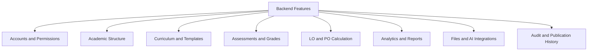

# Whiteboard için backend modül haritası

Mevcut tahtadaki Accounts → roller → öğrenci/hoca/bölüm başkanı/admin yapısı kullanıcı ihtiyaçlarını toplamak için uygundur. Servis mimarisinde bu dört rol aynı akademik modülleri farklı yetkilerle kullanır. Bu nedenle ders, not, hesaplama ve raporlama Accounts'ın altına değil, Accounts ile aynı seviyeye konmalıdır.

## Üst seviye harita



Rol kutuları ikinci bir görünümde kalabilir: “Öğrenci hangi servisi okuyabilir?”, “Öğretmen hangi dersin verisini değiştirebilir?” sorularını gösterir. Böylece bir not hesaplayıcısı öğrenci, öğretmen ve yönetici için üç defa yazılmaz.

## Tahtaya eklenecek kartlar

| Dal | Altına yazılacak özellikler | Backend sahibi | Öncelik |
| --- | --- | --- | --- |
| Accounts and Permissions | Login/logout/session, CSRF, kullanıcı yönetimi, rol + bölüm + ders kapsamı, hesap kapatma, yönetici destekli şifre yenileme | Murat Emre | MVP 0–1 |
| Academic Structure | Bölüm, akademik yıl/dönem, ders kataloğu, dönemlik ders açılışı, öğretmen ataması, öğrenci kaydı, kredi ve AKTS | Murat Emre | MVP 1 |
| Curriculum and Templates | Sürümlü PO seti, derse ait LO'lar, syllabus şablonu, kopyalama, geçmiş dönemi koruma | Murat Emre | MVP 1–2 |
| Assessments and Grades | Vize/final/proje/quiz, maksimum puan, ders not ağırlığı, not girişi, toplu kaydetme, eksik/muaf/sıfır, CSV | Poyraz | MVP 2–3 |
| LO and PO Calculation | Not normalizasyonu, assessment→LO, LO→PO, dersler arası PO birleştirme, kapsama, açıklanabilir formül | Poyraz | MVP 2–3 |
| Publication | Önizleme, geçici/final yayımlama, değişmez sonuç, gerekçeli düzeltme, eski sürüme erişim | Poyraz; reopen entegrasyonu Murat | MVP 2–3 |
| Analytics and Reports | Öğrenci profili, ders/bölüm dağılımı, dönem filtresi, örneklem, eksik veri, CSV raporu | Poyraz | MVP 3 |
| Files and AI Integrations | Syllabus PDF, job/worker, kaynaklı çıkarım, insan onayı, timeout/retry, manuel alternatif | Murat altyapı; Poyraz AI iş akışı | MVP 4 |
| Audit | Kim/ne/zaman/gerekçe, eski-yeni değer özeti, request ID, erişim kapsamı | Murat Emre | MVP 2–3 |
| Simulation | Varsayımsal notla PO değişimi; gerçek kayda yazma yok | Poyraz | MVP 5, isteğe bağlı |

API sözleşmesi, test ve Docker/deployment bütün modüllerin ortak gereksinimidir. Bunları ayrıca “Engineering Workflow” alanında issue → branch → PR → review → CI → integration → release akışıyla gösterin. Figma, backend tahtasında ayrı iş servisi değildir; frontend akışını ve API'nin hangi veriyi sağlaması gerektiğini belirleyen tasarım kanıtıdır.

## Mevcut rol kutularına yapılacak eklemeler

### Öğrenci

“Ders seçim ekranı” ilk sürümde **kayıtlı derslerim ve dönem filtresi** olarak daraltılabilir. Gerçek ders seçimi; kontenjan, önkoşul, çakışma ve danışman onayı gibi ayrı bir ürün alanı açar. Öğretim hedefi için önce yayımlanmış notlar, LO/PO profili, veri kapsamı ve hesap açıklaması daha değerlidir.

“Detaylı transkript” yerine ilk aşamada **ders ve başarı dökümü** yazın. Resmi transkript/GPA için harf notu, tekrar ders, kredi ve kurum politikası ayrıca gerekir. PO profilini bar grafik yanında erişilebilir tabloyla sunun. Öğrenci puanı hesaplayan/bağlantı kuran kişi değil, yayımlanmış sonucu gören kullanıcıdır.

### Hoca

Tahtaya açıkça **not girişi**, **CSV not aktarımı**, **hesap önizlemesi**, **yayımlama**, **not düzeltme gerekçesi** ve **sınıfın LO/PO analizi** ekleyin. Vize/proje tanımlamak ile öğrencinin o değerlendirmeden aldığı puanı girmek farklı işlemlerdir.

Katalog dersi oluşturma, ders açılışı ve öğrenci kaydı yetkisinin kimde olduğunu netleştirin. Planın varsayımı bölüm yöneticisinin bunları yapması, öğretmenin atandığı derste şablon/not yönetmesidir. Öğretmene kayıt yetkisi verilecekse atandığı ders kapsamıyla sınırlı açık bir yetki olsun.

### Bölüm başkanı

**PO seti sürümleme**, **öğretmen atama**, **müfredatta hiç ölçülmeyen PO'ları görme**, **eksik not/eksik eşleme takibi**, **dönem karşılaştırması**, **yeniden açma/onay** ve **rapor dışa aktarma** ekleyin. Bölüm ortalamasının yanında öğrenci sayısı ve veri kapsamı görünmeli; birkaç öğrencinin puanı bütün bölümü temsil ediyormuş gibi sunulmamalı.

### Admin

Teknik hesap/rol yönetimi, sistem ayarları, entegrasyon sağlığı ve operasyon işlemlerini ekleyin. PO akademik içeriğinin birincil sahibi bölüm başkanı olsun; admin'e otomatik akademik karar yetkisi verilmesin. Aynı kişide iki rol gerektiğinde ayrı yetkiler olarak atanabilir.

## Hesaplama alanına yapıştırılacak not

**Birbirinden farklı dört alan var:** ders genel not yüzdesi; assessment→LO ağırlığı; ders içi LO→PO ağırlığı; dersler arası 1–5 PO katkısı. Yalnız ders genel not yüzdeleri toplamı %100 olmak zorundadır. Hocanın örneğinde bir LO'ya gelen ağırlıklar toplamı %140 olabilir ve ağırlıklı ortalamada normalize edilir.

Tahtadaki “LO→PO (1–5)” etiketini kesin kurum kuralı kabul etmeden G s.7'nin yorumu öğretim elemanıyla netleştirilmeli. [Hesaplama planı](03-HESAPLAMA-VE-AKADEMIK-KURALLAR.md) iki katmanı ayıran bir başlangıç politikası tanımlar. PO açılımı Program Outcome, yani **program çıktısıdır**.

## Her modül kartının altındaki sözleşme

```text
Modül: Not Yönetimi
Backend sahibi: Poyraz Bingöl
Frontend tüketicisi: Mehmet Ali Altınbaş
Reviewer: Murat Emre Öztürk
MVP: 2
Girdi: enrollment_id, assessment_id, state, raw_score, expected_revision
API: PATCH /api/v1/offerings/{id}/grades/bulk/
Çıktı: yeni revision ve değişmiş hücreler
Yetki: yalnız atandığı dersin öğretim elemanı
Bağımlılık: academic context ve assessment tanımları
Bağımsız geliştirme: sabit DTO/fixture + mock API
Kabul: geçersiz tek hücrede hiçbir kayıt yazılmaz; eski revision 409 döner
Kanıt: issue, sözleşme PR'ı, review, transaction testi, gerçek UI demosu
```

Tahtayı bu seviyeye indirdiğinizde “backend'de not yönetimi var” cümlesi, kimin neyi hangi arayüzle teslim edeceği belli bir iş paketine dönüşür. Tam endpoint listesi [API sözleşmelerinde](04-API-SOZLESMELERI.md), kişisel işler [Murat Emre](07-MURAT-EMRE-OZTURK.md) ve [Poyraz](08-POYRAZ-BINGOL.md) dosyalarındadır.
